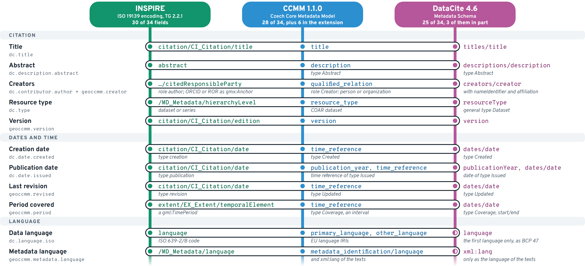
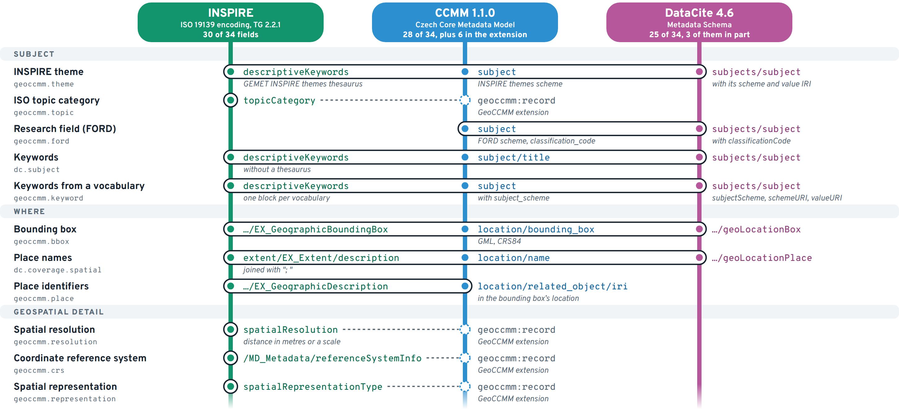
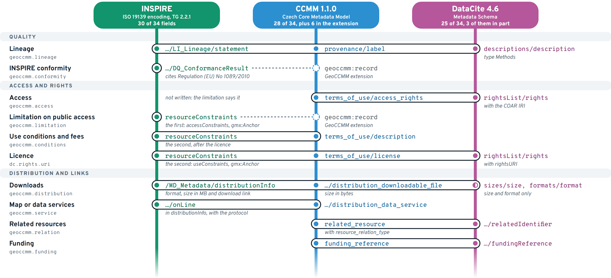
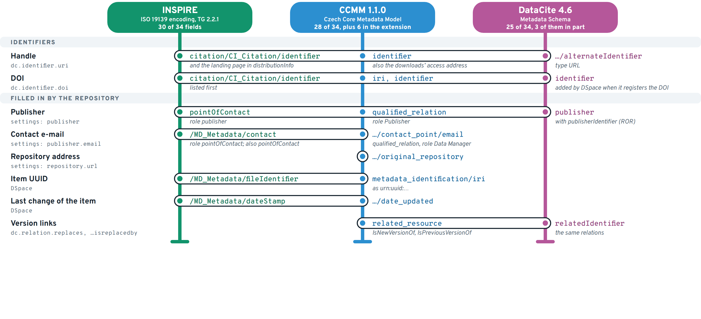

# GeoCCMM

GeoCCMM is a metadata application profile for geospatial research data in CLARIN-DSpace. A dataset is described once, in one DSpace record, and the record maps to three standards:

- **CCMM 1.1.0**, the Czech Core Metadata Model for research data
- **INSPIRE**, ISO 19139 encoding, Technical Guidelines 2.2.1
- **DataCite Metadata Schema 4.6**

GeoCCMM is a prototype. Fields and values may still change.

## Fields

34 fields, stored in Dublin Core (`dc`) and the DSpace schema `geoccmm`.

| Filled in by | Fields |
|---|---|
| Depositor, required (10) | Title, Abstract, Creators, Data language, Creation date, Lineage, INSPIRE theme, ISO topic category, Research field (FORD), Bounding box |
| Default value (6) | Metadata language, Resource type, Publication date, Access, Limitation on public access, INSPIRE conformity |
| DSpace (3) | Licence, Handle, DOI |
| Depositor, optional (15) | Version, Last revision, Keywords, Keywords from a vocabulary, Place names, Place identifiers, Period covered, Spatial resolution, Coordinate reference system, Spatial representation, Use conditions and fees, Downloads, Map or data services, Related resources, Funding |

21 fields are shared by all three standards, 3 by INSPIRE and CCMM, 4 by CCMM and DataCite, and 6 by INSPIRE alone. The CCMM export carries the whole record, those 6 included, in a `geoccmm:record` element.

## Crosswalk

Each field with its DSpace key and its place in each standard. A half-filled dot means the standard takes the field only in part; a dashed line means CCMM has it only in `geoccmm:record`. The last table also shows what the repository adds from its settings and from DSpace.

## Files

| Path | Contents |
|---|---|
| [`model/geoccmm-core.json`](model/geoccmm-core.json) | The profile: each field's DSpace key, English and Czech labels and hints, input type, cardinality, who fills it in, which standards require it, and its allowed values |
| [`model/vocabularies.json`](model/vocabularies.json) | The code lists the fields use |
| [`dspace/`](dspace/) | Configuration for CLARIN-DSpace 2026.2 (DSpace 7.6.5): metadata schema, submission forms in English and Czech, submission steps, and the DataCite stylesheet that DSpace runs when it registers a DOI. Installation: [`dspace/README.md`](dspace/README.md) |
| [`examples/commuting-table/`](examples/commuting-table/) | A made-up record and its CCMM, INSPIRE and DataCite exports |
| [`NOTICE.md`](NOTICE.md) | Sources of the code lists |

The CCMM and INSPIRE exports in `examples/` were made with the GeoCCMM tools, which are not in this repository; the DataCite export comes from the stylesheet in `dspace/`, built with example settings. All three validate against the official XML schemas of CCMM 1.1.0, ISO 19139 and DataCite 4.6. They have not been run through the INSPIRE validator.
